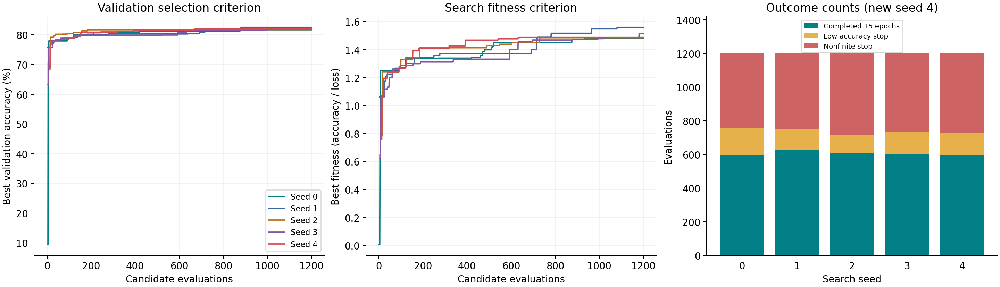
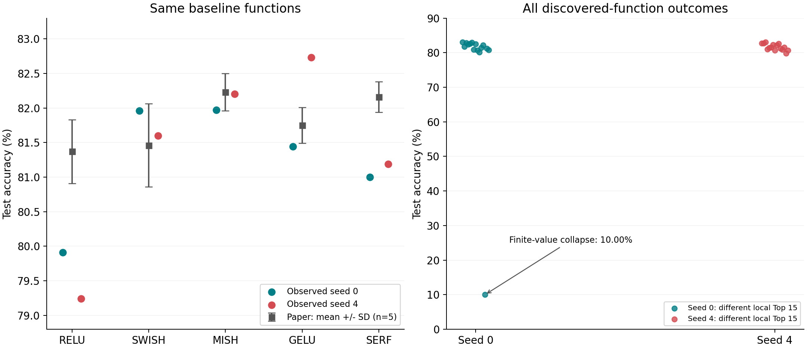

# 新しいseed 4を採用した実行結果の再評価

分析日：2026-10-21。対象はCIFAR-10・論文Table 2のBase CNN。新しい `paper_full_seeds4` を採用して全5探索を再集計した。元データと既存の分析は保存し、このフォルダーに更新版を出力した。追加学習は実施していない。

**探索段階では、旧seed 4の連続した実行エラーによる欠損が解消した。一方、同じ上位15関数を5シードで再学習する検証はまだ完了していない。新seed 4の最高テスト精度は83.07%だが、この単回最大値だけで論文の5回平均に対する優位性は主張できない。**

## 1. 以前の結論から変わった点

| 項目 | 旧seed 4を含む分析 | 新seed 4を採用した分析 |
| --- | --- | --- |
| 採用する探索記録数 | 6,000 | 6,000（旧seed 4を置換） |
| 探索15エポック完走 | 2,593 | **3,032** |
| 完走した数式文字列の種類数 | 867 | **1,000** |
| 採用探索内のログで確認された実行例外 | 851 | **0** |
| seed 4の最高検証精度 | 80.66%（途中まで） | **81.94%** |
| テスト評価が保存された再学習seed | 0のみ | **0と4** |
| 有限値のテスト評価記録 | 20 | **40** |
| 全観測中の最高テスト精度 | 83.05% | **83.07%**（別の関数、別のseed） |
| 全探索から選んだ上位15候補 | 旧一覧 | **14候補を維持、1候補を入れ替え** |

「再学習結果があるのはseed 0だけ」「seed 4の大半は実行エラー」という説明は、更新後の採用データには当てはまらない。旧結果で実際に起きたエラーの記録自体は残る。

## 2. 入力の選択と確認

| 探索seed | 採用フォルダー |
| --- | --- |
| 0 | `paper_full_results/paper_full_seeds0` |
| 1 | `paper_full_results/paper_full_seeds1` |
| 2 | `paper_full_results/paper_full_seeds2` |
| 3 | `paper_full_results/paper_full_seeds3 and 4` |
| 4 | **`paper_full_results/paper_full_seeds4`** |

seed 3の382件の途中版と、旧seed 4の1,200件は集計に加えていない。新旧seed 4を連結すると同じ探索seedを二重に数えるため、1回分を置き換える。

確認事項：

- 採用した各seedの評価番号は1〜1,200まで欠番・重複なし。探索CSVはcheckpointの当該seedの記録と一致。
- 各runの保存ソースのSHA-256はmanifestの記録と一致。学習条件、関数番号の定義、保存された訓練・検証分割は採用run間で一致。
- CIFAR-10は訓練45,000枚、検証5,000枚、テスト10,000枚。探索15エポック、再学習50エポック、SGD 0.01、momentum 0.9、batch 64。
- TensorFlow 2.21.0、Keras 3.12.4、NumPy 2.2.6、scikit-learn 1.7.2。新旧seed 4の主要ソースは同じだったため、今回の結果だけから「コード変更によってOOMを解決した」とは言えない。
- 保存済み再学習41行について履歴のエポック数を照合。完走40行について指標の有限性とモデルファイルの存在を確認。有限値でも精度10%の学習崩壊は除外していない。
- ユーザー提供PDFのSHA-256は以前の参照記録と一致。Table 3とTable 6を比較対象とし、別モデル・別データセットの数値は混ぜない。

採用元・検査情報：[audit.json](audit.json)。選定は既存の再学習専用コードと同じ規則を使った。

## 3. 全5シードの探索結果

| seed | 記録数 | 15 epoch完走 | 低精度打ち切り | 非有限値打ち切り | ログ上の実行例外 | 最高検証精度 | 最高値の世代 |
| --- | ---: | ---: | ---: | ---: | ---: | ---: | ---: |
| 0 | 1,200 | 595 | 160 | 445 | 0 | 81.68% | 30 |
| 1 | 1,200 | 630 | 119 | 451 | 0 | 82.50% | 30 |
| 2 | 1,200 | 611 | 104 | 485 | 0 | 81.72% | 19 |
| 3 | 1,200 | 600 | 137 | 463 | 0 | 81.86% | 40 |
| 4（新） | 1,200 | 596 | 130 | 474 | 0 | 81.94% | 23 |
| **合計** | **6,000** | **3,032** | **650** | **2,318** | **0** | — | — |

完走率は50.53%、低精度打ち切りは10.83%、非有限値打ち切りは38.63%。今回採用した結果に0エポックの記録はない。候補ごとの数値的不安定性は依然として多く、計算資源の実行エラーがなくなったことと区別する必要がある。

各探索の最高検証精度の平均±標本SDは **81.94±0.33%（5探索）**。これは選抜された検証最高値のばらつきであり、同一関数を再学習したテスト精度の平均±SDではない。

新seed 4は第1世代から最高検証精度が4.12ポイント改善した。一方、seed 3は第40世代でも最高値を更新している。40世代で必ず収束する、あるいはGAが同予算のランダム探索より優れる、とまでは今回の結果から言えない。



線は「それまでの完走候補の最大値」。fitnessは検証精度/検証損失で、候補選定に使う検証精度とは別の指標。最初の完走候補が出る前の値は欠損として扱う。

集計：[search_seed_summary.csv](search_seed_summary.csv)。全6,000記録：[search_evaluations_selected.csv](search_evaluations_selected.csv)。

## 4. 統合Top 15の変化

15エポック完走・有限値の候補を検証精度の降順に並べ、同じ数式文字列を1候補にまとめた。同率は検証損失、探索seed、評価番号の順で決定。テスト精度は選定に使っていない。

| 更新後順位 | 探索seed | 関数 | 検証精度 | 変更点 |
| --- | ---: | --- | ---: | --- |
| 1 | 1 | `erf(x)*sigmoid(sinh(x))` | 82.50% | 維持 |
| 2 | 4 | `sigmoid(x)*erf(erf(x))` | 81.94% | 旧6位。従来の最高81.62%を更新 |
| 3 | 3 | `atan(x)*sigmoid(sinh(x))` | 81.86% | 旧2位 |
| 4 | 2 | `asinh(x)*sigmoid(sinh(x))` | 81.72% | 旧3位 |
| 5 | 0 | `sigmoid(x)*erf(sin(x))` | 81.68% | 旧4位 |
| 13 | 4 | `atan(x)*min(x,0)+tanh(x)` | 80.88% | **新規にTop 15入り** |

旧15位の `sigmoid(x)*sin(x)`（80.58%）が外れた。新しい15位の検証精度は80.68%。全15件は [pooled_top15.csv](pooled_top15.csv)、変更一覧は [pooled_top15_changes.csv](pooled_top15_changes.csv)。

数式文字列による重複除去なので、数学的に異なる15関数とは限らない。例えば7位の `sigmoid(x)*erf(x)` と10位の `erf(x)*sigmoid(x)` は数学的に同一。今回も実行コードの選定規則を維持した。

探索中に同一関数を異なる初期化で繰り返し評価しているため、最高検証精度は関数の典型的な性能とは異なる。新しいseed 4を加えても探索全体の最高82.50%は変わらず、最高値から再学習性能を直接予測することはできない。

## 5. 再学習の観測結果

seed 0はローカルTop 15と比較関数5個の20件、seed 4もローカルTop 15と比較関数5個の20件でテスト評価が保存されている。seed 4のELUは1エポック目にloss/val_lossがNaNとなり、テスト評価はない。seed 0のELUは以前のOOMで結果行が未保存。

### 各runの発見関数

| run内の名前 | 再学習seed | テスト精度 | 同じseedのReLUとの差 |
| --- | ---: | ---: | ---: |
| discovered_01（seed 0側） | 0 | 83.05% | +3.14 pt |
| discovered_06（seed 0側） | 0 | 82.89% | +2.98 pt |
| discovered_03（seed 0側） | 0 | 82.78% | +2.87 pt |
| discovered_03（seed 4側） | 4 | **83.07%** | **+3.83 pt** |
| discovered_02（seed 4側） | 4 | 82.75% | +3.51 pt |
| discovered_01（seed 4側） | 4 | 82.69% | +3.45 pt |

新seed 4の最高関数は `sigmoid(x)*erf(atan(x))`。seed 0の最高関数 `sigmoid(x)*erf(sin(x))` とは異なる。83.05%から83.07%への0.02ポイント差を、同一関数の性能改善として扱わない。

このseed 4のテスト最高候補も、検証精度で選んだ新しい統合Top 15には含まれていない。テスト最高だからという理由で選定済み候補へ追加しない。

seed 0は15候補中14候補、seed 4は15候補すべてが同じseedのReLUを上回った。新seed 4の最小値は79.86%。seed 0の `discovered_13` は有限値のまま最終テスト精度10.00%に崩壊しており、更新後もこの失敗例を保持した。

**seed 0とseed 4の発見15候補は、数式文字列で照合すると共通候補が0個。** `discovered_01`などの順位名だけで対応づけて平均してはいけない。一般的な数学的同値性の判定は行っていない。

観測一覧：[retraining_observations.csv](retraining_observations.csv)。

### 新しい統合Top 15に対する再学習の充足度

既存のテスト評価に同じ数式文字列があるのは、統合順位 **2、5、11、12、13位の5候補**のみ。各1シードの観測しかなく、残り10候補には保存済みテスト評価がない。探索1位も保存済みテスト精度はない。

したがって、統合Top 15のうち5反復がそろった候補は **0/15**。既存の40件を、新しい共通Top 15×5回の完了件数とみなすことはできない。今回は観測の対応関係を整理しただけで、新しい再学習計画には過去の結果を取り込んでいない。

対応表：[pooled_retraining_coverage.csv](pooled_retraining_coverage.csv)。

## 6. 元論文との比較を更新する

参照：ユーザー提供 *Activation Function Optimization Scheme for Image Classification*、arXiv:2409.04915v1、Table 3（p.16）とTable 6のBase CNN列（p.19）。以下のptはパーセントポイント。

### 同一の比較関数

| 関数 | 論文の平均±SD（5回） | 今回seed 0 | 今回seed 4 | 2観測の平均（参考） | 参考平均−論文（pt） |
| --- | ---: | ---: | ---: | ---: | ---: |
| ReLU | 81.37±0.46% | 79.91% | 79.24% | 79.575% | −1.795 |
| Swish | 81.46±0.60% | 81.96% | 81.60% | 81.780% | +0.320 |
| Mish | 82.23±0.27% | 81.97% | 82.20% | 82.085% | −0.145 |
| GELU | 81.75±0.26% | 81.44% | 82.73% | 82.085% | +0.335 |
| SERF | 82.16±0.22% | 81.00% | 81.19% | 81.095% | −1.065 |
| ELU | 82.29±0.57% | OOM・未保存 | NaN・未評価 | — | — |

2観測の平均は説明用の参考集計であり、5反復を要求する新ランナーの正式な完了平均ではない。seed 0と4の標本SDはCSVに残したが、n=2であり安定性や有意差の根拠にはしない。

- **ReLUとSERFの低下はseed 4でも続いた。** seed 0だけの偶然とする説明は弱まるが、2観測で原因は断定できない。
- **GELUはseed 0からseed 4で1.29 pt高くなった。** 1回の評価で基準関数の優劣を判断する危険性を示す。
- Mishは論文平均に近く、Swishは両seedとも論文平均より高い。全関数に共通の一定補正を加える説明は適切でない。
- ELUは両seedとも有効な評価がないため、既存6関数すべてを上回ったとは言えない。



左のエラーバーは論文の標準偏差で、95%信頼区間ではない。右は各runで異なる15候補の観測値であり、同一関数の反復分布ではない。

詳細：[baseline_paper_comparison.csv](baseline_paper_comparison.csv)。

### 論文Table 3と同じ発見関数が評価された

新seed 4の `discovered_04` は `softplus(x)*erf(erf(x))`。これは論文Table 3に掲載された数式と一致する。今回は **81.02%（1回）**、論文は **82.40±0.47%（5回）**で、差は **−1.38 pt**。

以前の「同じ関数の比較はbaselineだけ」という整理を更新できる。これは同じ関数での差を調べる具体的な材料だが、1回対5回平均であり、実装・分割・初期化・実行環境のどれが原因かは切り分けられない。

この関数は新しい統合Top 15には入っていない。テスト結果を見てTop 15に追加することはせず、必要なら論文掲載関数の固定比較という別枠で扱う。

数値：[paper_table3_same_function.csv](paper_table3_same_function.csv)。

### 最高値とReLUとの差

今回の最高83.07%は、論文Base CNN最高平均82.74%（EELU-4）より数値上0.33 pt高い。ただし別の関数の単回最大値と5回平均の比較であり、論文を上回る再現結果とはまだ言えない。

- 論文：82.74−81.37 = **1.37 pt**。
- 新seed 4：83.07−79.24 = **3.83 pt**。
- 改善幅の差：3.83−1.37 = **2.46 pt = 最高関数側の差0.33 pt + ReLU側の低下2.13 pt**。

この算術分解から、ReLUに対する大きな改善幅には基準となるReLUの低さも寄与している。因果効果の推定ではない。seed 4の最も高い有効baselineであるGELU（82.73%）と比べた最高候補の差は0.34 pt。

### 論文EELUの探索内出現

直接的な数式表記による照合では、EELU-1は8記録・7完走、EELU-4は3記録・2完走。両者の最高検証精度は79.96%で以前と変わらず、新Top 15の閾値80.68%を下回る。EELU-2/3は指定した直接表記では未検出。代数的同値表現を網羅した検索ではない。

EELU-1/4は生成・評価できているが、今回の選定規則では残っていない。両者の50エポックのテスト評価は未取得なので、短期探索と長期学習で順位が逆転するかは未確認。`softplus(x)*erf(erf(x))`はEELU-4の `softplus(x)*erf(x)` と異なる関数である。

## 7. 何が未解決か

1. **共通Top 15＋比較6関数について、5シードの再学習が未完了。** 新seed 4を含む選定で候補を固定してから、105試行をそろえる必要がある。
2. **非有限値による不安定性。** 探索中2,318件の打ち切りと、ELUの再学習NaNが残る。原因を確定するには活性値・勾配などの追加記録が必要。
3. **有限値の学習崩壊。** seed 0の1候補はテスト10%。`completed`だけで成功と判断しない。
4. **基準関数の再現差。** ReLU・SERFの低下が続き、GELUのseed間差も大きい。条件の記載が一致していても、論文と同じ画像分割、具体的seed、dropout等を使ったことまでは証明できない。
5. **新seed 4の終了後のグラフ生成エラー。** `matplotlib`不足で実行全体は`failed`だが、これは学習後の処理。今回の分析では保存済みCSVと履歴を使って図を生成した。元runの状態ファイルは書き換えていない。

今回採用した探索ではOOM例外を確認しなかったが、単一試行のメモリ不足や別環境での再発まで否定できない。旧seed 3途中版などの履歴上のエラーを「発生しなかった」ことにはしない。

## 8. 更新後の再学習へ進む場合

再学習自体は今回の分析では実行していない。新しい計画を作成するコマンド：

```bash
python retrain_paper.py --results-root paper_full_results --source "4=paper_full_results/paper_full_seeds4" --output retrain_runs/pooled_top15_updated --plan-only
```

未作成の出力先を指定する。既存の `pooled_top15_prepared` は旧候補を固定しているため、新しい結果を自動反映しない。詳細は [日本語実行手順](../../RETRAIN_POOLED_JA.md) / [English instructions](../../RETRAIN_POOLED_EN.md)。

この分析のCSV内のaccuracyは、列名が`_pct`で終わるものを除き0〜1の比率。`_pp`はパーセントポイント。平均・SDの母集団が「探索最高値」「同じbaselineの2観測」「同じ関数の5再学習」のどれかを区別して読むこと。
