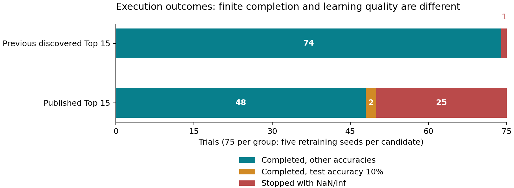
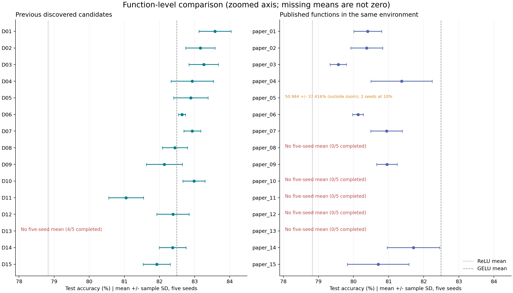

# Matched retraining comparison: discovered Top 15 versus published Top 15

Analysis date: 2026-10-25

[日本語版](README_JA.md)

Saved results were audited and reaggregated without additional training or changes to source data. The comparison covers the previous 15 candidates selected using all searches including the updated seed 4, and the newly executed 15 functions from Table 3 of the paper.

## Main findings

**Under this implementation, recorded environment and data split, the previous discovered candidates showed both a higher observed best mean accuracy and a higher numerical completion rate.** This is a result for these conditions, not evidence of universal superiority over the paper's method or across other datasets.

| Measure | Previous discovered Top 15 | Published Top 15 rerun |
|---|---|---|
| Planned trials | 75 | 75 |
| Completed 50 epochs and test evaluation | 74/75 (98.67%) | 50/75 (66.67%) |
| NaN/Inf stops | 1/75 (1.33%) | 25/75 (33.33%) |
| Candidates with 5 completed seeds | 14/15 | 10/15 |
| Completed trials at 10% test accuracy | 0 | 2 (paper_05, seeds 0, 3) |
| Best mean ± SD (%) | discovered_01: 83.582 ± 0.460 | paper_14: 81.710 ± 0.747 |

The best discovered candidate exceeds the best rerun published function by **1.872 percentage points (pp)**, and the rerun of EELU-4, the paper's original leader, by **3.176 pp**. Thirteen of the 14 discovered candidates with complete results exceed the best published-function rerun mean of 81.710%.

Discovered candidates 07 and 10 are mathematically identical. The previous set contains a duplicate, and both entries are included among the 13 candidates above; these are not 13 mathematically distinct functions.

## 1. Comparison conditions and verification

| Item | Conditions / checks |
|---|---|
| Data | CIFAR-10: 45,000 train / 5,000 validation / 10,000 test |
| Retraining | 50 epochs from scratch; seeds 0, 1, 2, 3, 4 |
| Optimization | SGD; learning rate 0.01; momentum 0.9; batch size 64 |
| CNN | 6 convolutions: 28, 32, 64, 64, 128, 128; dropout 0.2; he_uniform |
| Runtime | Linux; RTX 4080 SUPER; Python 3.10.12; TensorFlow 2.21.0; Keras 3.12.4 |
| Packages | NumPy 2.2.6; scikit-learn 1.7.2 |
| Execution | JIT disabled; memory growth enabled; one process per trial |
| Evaluation | Final model after 50 epochs; test set excluded from training |

The full configurations, runtime settings and split-file SHA-256 match. Code recorded as preserved in the published-function plan, including the model, data loader, evaluator, training and accounting, matches the previous snapshot hashes. The worker differs in environment recording/checking. Across 180 trials (105 previous trials, including 30 baseline trials, plus 75 published-function trials), IDs, planned functions/seeds, CSV versus JSON metrics, histories, saved models, environments and summaries were checked.

Split SHA-256: `fb97511b4fe6df79b37aa851875d193c93e3cef5b6c836e013941f1301fb9858`

Recorded comparison environment fields match for all 180 trials, and all 75 published-function environment checks passed. Original GPU driver versions and every environment variable were not recorded, and bitwise GPU determinism is not guaranteed. Matching conditions refers to this verifiable scope.

Means are reported only for functions with all five successful seeds; SD is the sample standard deviation (ddof=1). Failed trials are neither replaced with 0% nor omitted to manufacture an official mean. Differences below are percentage-point differences, not relative percentage improvements.

## 2. Execution status of the published Top 15

**All 75 trials have terminal outcomes: none are pending or running. Fifty completed and 25 failed numerically.** `all_evaluations_completed=false` reflects unsuccessful trials, not unfinished scheduling. There are 50 saved models and no recorded model-save errors.



Teal denotes completed trials other than the two at 10%; orange denotes those two completed trials; red denotes NaN/Inf stops. The previous 30 baseline trials are excluded from this 75-versus-75 figure.

| Function | Failed seeds | Completed | First nonfinite epoch | loss NaN | loss Inf | val_loss NaN |
|---|---|---|---|---|---|---|
| paper_08 | 0–4 | 0/5 | 1 | 4 | 1 | 5 |
| paper_10 | 0–4 | 0/5 | 1 | 4 | 1 | 5 |
| paper_11 | 0–4 | 0/5 | 1 | 5 | 0 | 5 |
| paper_12 | 0–4 | 0/5 | 1 | 5 | 0 | 5 |
| paper_13 | 0–4 | 0/5 | 1 | 5 | 0 | 5 |

The first nonfinite epoch is epoch 1 in all 25 failures. Training loss is NaN in 23 trials and Inf in two; validation loss is NaN in all 25. Accuracy and validation accuracy remain finite at the recorded failing epoch, so finite accuracy does not establish valid training. No test evaluation is recorded for these failed trials.

The 75 published-function logs contain zero OOM matches and zero tracebacks. Layout optimizer warnings appear in 75 logs, including successful trials; the warning alone does not identify the cause.

### paper_05: finite metrics can still accompany failed learning

| seed | Test accuracy (%) |
|---|---|
| 0 | 10.00 |
| 1 | 78.22 |
| 2 | 78.98 |
| 3 | 10.00 |
| 4 | 77.72 |

Seeds 0 and 3 completed 50 epochs but achieved 10.00% test accuracy, with final training loss around 2.303. This is chance-level behavior for ten classes, not successful learning to high accuracy. Because metrics are finite, the execution status is nevertheless completed. Both trials remain included in the official **50.984 ± 37.416%** five-seed result. Raw predictions and gradients are unavailable, so behaviors such as always predicting one class are not established.

## 3. All 15 published functions: rerun versus reported results

| Published function | Completed | Reported mean ± SD (%) | Rerun mean ± SD (%) | Rerun − paper (pp) |
|---|---|---|---|---|
| paper_01 (EELU-4) | 5/5 | 82.74 ± 0.14 | 80.406 ± 0.396 | -2.334 |
| paper_02 (EELU-2) | 5/5 | 82.67 ± 0.30 | 80.376 ± 0.455 | -2.294 |
| paper_03 (EELU-1) | 5/5 | 82.66 ± 0.29 | 79.566 ± 0.234 | -3.094 |
| paper_04 (EELU-3) | 5/5 | 82.48 ± 0.61 | 81.370 ± 0.873 | -1.110 |
| paper_05 | 5/5 | 82.46 ± 0.54 | 50.984 ± 37.416 | -31.476 |
| paper_06 | 5/5 | 82.44 ± 0.37 | 80.130 ± 0.154 | -2.310 |
| paper_07 | 5/5 | 82.40 ± 0.47 | 80.940 ± 0.451 | -1.460 |
| paper_08 | 0/5 | 82.38 ± 0.39 | Not reported | — |
| paper_09 | 5/5 | 82.29 ± 0.18 | 80.952 ± 0.293 | -1.338 |
| paper_10 | 0/5 | 82.27 ± 0.35 | Not reported | — |
| paper_11 | 0/5 | 82.26 ± 0.13 | Not reported | — |
| paper_12 | 0/5 | 82.25 ± 0.47 | Not reported | — |
| paper_13 | 0/5 | 82.19 ± 0.51 | Not reported | — |
| paper_14 | 5/5 | 82.15 ± 0.29 | 81.710 ± 0.747 | -0.440 |
| paper_15 | 5/5 | 82.15 ± 0.33 | 80.704 ± 0.878 | -1.446 |

Reported values are the Table 3 values from the supplied arXiv:2409.04915v1 PDF transcribed into the frozen plan. `paper_XX` denotes Table 3 row order, not EELU numbering or rerun rank.

All ten functions with five completed repetitions have rerun means below their published means. Even excluding paper_05, the nine differences range from −0.440 to −3.094 pp. EELU-4, the paper's leader, achieves 80.406% here, while paper_14 leads the reruns at 81.710%. Transferring the functions into this implementation did not reproduce the paper's accuracy levels or ordering.

### Per-seed test accuracy for the published functions (%)

| Function | seed 0 | seed 1 | seed 2 | seed 3 | seed 4 |
|---|---|---|---|---|---|
| paper_01 | 80.72 | 80.19 | 79.83 | 80.51 | 80.78 |
| paper_02 | 79.71 | 80.75 | 80.10 | 80.72 | 80.60 |
| paper_03 | 79.67 | 79.89 | 79.26 | 79.53 | 79.48 |
| paper_04 | 82.18 | 81.81 | 81.40 | 79.90 | 81.56 |
| paper_05 | 10.00 | 78.22 | 78.98 | 10.00 | 77.72 |
| paper_06 | 80.02 | 80.16 | 80.23 | 79.93 | 80.31 |
| paper_07 | 81.42 | 80.49 | 80.58 | 81.42 | 80.79 |
| paper_08 | NaN/Inf stop | NaN/Inf stop | NaN/Inf stop | NaN/Inf stop | NaN/Inf stop |
| paper_09 | 81.19 | 80.80 | 80.58 | 80.89 | 81.30 |
| paper_10 | NaN/Inf stop | NaN/Inf stop | NaN/Inf stop | NaN/Inf stop | NaN/Inf stop |
| paper_11 | NaN/Inf stop | NaN/Inf stop | NaN/Inf stop | NaN/Inf stop | NaN/Inf stop |
| paper_12 | NaN/Inf stop | NaN/Inf stop | NaN/Inf stop | NaN/Inf stop | NaN/Inf stop |
| paper_13 | NaN/Inf stop | NaN/Inf stop | NaN/Inf stop | NaN/Inf stop | NaN/Inf stop |
| paper_14 | 81.83 | 80.74 | 81.45 | 82.81 | 81.72 |
| paper_15 | 81.05 | 81.23 | 79.16 | 80.84 | 81.24 |

## 4. Accuracy comparison with the previous discovered Top 15

| Mean rank | Discovered candidate | Completed | Mean ± SD (%) | Difference from best published rerun (pp) |
|---|---|---|---|---|
| 1 | discovered_01 | 5/5 | 83.582 ± 0.460 | +1.872 |
| 2 | discovered_03 | 5/5 | 83.260 ± 0.422 | +1.550 |
| 3 | discovered_02 | 5/5 | 83.162 ± 0.418 | +1.452 |
| 4 | discovered_10 | 5/5 | 82.982 ± 0.316 | +1.272 |
| 5 | discovered_04 | 5/5 | 82.934 ± 0.607 | +1.224 |
| 5 | discovered_07 | 5/5 | 82.934 ± 0.239 | +1.224 |
| 7 | discovered_05 | 5/5 | 82.892 ± 0.490 | +1.182 |
| 8 | discovered_06 | 5/5 | 82.642 ± 0.100 | +0.932 |
| 9 | discovered_08 | 5/5 | 82.438 ± 0.361 | +0.728 |
| 10 | discovered_12 | 5/5 | 82.384 ± 0.460 | +0.674 |
| 11 | discovered_14 | 5/5 | 82.374 ± 0.382 | +0.664 |
| 12 | discovered_09 | 5/5 | 82.140 ± 0.516 | +0.430 |
| 13 | discovered_15 | 5/5 | 81.920 ± 0.385 | +0.210 |
| 14 | discovered_11 | 5/5 | 81.050 ± 0.493 | -0.660 |
| — | discovered_13 | 4/5 | Not reported | — |

Candidates 04 and 07 tie at the displayed precision of 82.934%. Candidate 13 lacks a five-run mean because seed 1 became NaN in epoch 50. Its successful seeds 0, 2, 3 and 4 achieved 81.31%, 79.95%, 81.84% and 81.57%; a four-run mean is not inserted into the ranking.



The figure shows means ± sample SD on a zoomed axis. paper_05's 50.984% is explicitly labeled as outside the view. Unavailable means are not plotted as zero. Reference lines use the previous baseline results; baselines were not rerun in the new 75 trials.

### Best observed functions compared at the same seeds

| seed | discovered_01 (%) | paper_14 (%) | 差 / Difference (pp) |
|---|---|---|---|
| 0 | 83.82 | 81.83 | +1.99 |
| 1 | 83.75 | 80.74 | +3.01 |
| 2 | 82.77 | 81.45 | +1.32 |
| 3 | 83.69 | 82.81 | +0.88 |
| 4 | 83.88 | 81.72 | +2.16 |

discovered_01 exceeds paper_14 at all five seeds, with a mean difference of +1.872 pp. Its mean difference is +3.176 pp versus EELU-4 and +2.212 pp versus EELU-3, the best EELU rerun. These are observed differences, not significance-test results. Both leaders are identified after observing test results, so the comparison also involves selection effects.

## 5. Baseline context

| Baseline | Completed | Mean ± SD (%) |
|---|---|---|
| relu | 5/5 | 78.824 ± 0.601 |
| swish | 5/5 | 81.794 ± 0.545 |
| mish | 5/5 | 81.124 ± 0.601 |
| gelu | 5/5 | 82.490 ± 0.448 |
| serf | 5/5 | 80.462 ± 0.592 |
| elu | 0/5 | Not reported |

These baselines come from the previous 105-trial experiment, not new baseline runs in the 75-trial evaluation. The best published rerun, paper_14, is 0.780 pp below GELU and 0.084 pp below Swish. Eight previous discovered candidates exceeded GELU. ELU failed at all five seeds in the previous run, so it has no comparable mean.

## 6. Interpretation, limitations, and next checks

1. **Fit to this implementation:** The previous candidates were selected by validation accuracy using this split and implementation. The published functions are a fixed set selected in another experiment. Better accuracy and completion of the previous candidates are consistent with adaptation to these conditions, but do not establish a single cause.
2. **Separate matched comparison from exact paper reproduction:** Conditions between these two runs were checked; identity with the original paper's precise split/environment was not established. EELU-2 follows the mathematical formula rather than Table 4's duplicated code. EELU-3 uses the existing product expression tree, and softplus uses the same stable implementation as the previous run.
3. **NaN/Inf origins remain unknown:** No OOM is recorded. For example, failed paper_13=`max(x,erf(x))` contains neither exp nor a domain-restricted inverse trigonometric function, so exponential overflow alone cannot explain all failures. Capture the first nonfinite activation, convolution, gradient or weight update.
4. **Avoid survivor-only conclusions:** Do not headline a group-wide average after excluding incomplete functions, or a paper_05 average after dropping its two 10% trials. Report completion and accuracy together without hiding missing outcomes.
5. **Next experiments:** Instrument seed 0 of paper_08/10/11/12/13, and examine initial outputs, losses and gradients for paper_05 seeds 0 and 3. Previous candidate 13 seed 1 and ELU remain unresolved. Report learning-rate changes or clipping as separate experiments without overwriting the original records.
6. **Generalization limits:** Five seeds are repeated training runs on one data split, not five independent datasets. Additional splits, models or an independently fixed comparison plan are needed.

## Appendix: evaluated function expressions

Expressions follow the frozen execution plans. `log(1+exp(x))` is implemented with `tf.nn.softplus`.

| Previous candidate | Expression |
|---|---|
| discovered_01 | `(erf(x)*sigmoid(sinh(x)))` |
| discovered_02 | `(sigmoid(x)*erf(erf(x)))` |
| discovered_03 | `(atan(x)*sigmoid(sinh(x)))` |
| discovered_04 | `(asinh(x)*sigmoid(sinh(x)))` |
| discovered_05 | `(sigmoid(x)*erf(sin(x)))` |
| discovered_06 | `(asinh(x)*sigmoid(x))` |
| discovered_07 | `(sigmoid(x)*erf(x))` |
| discovered_08 | `(sigmoid(x)*erf(sinh(x)))` |
| discovered_09 | `max(min((exp(x)*erf(tanh(x))),0),(x*sigmoid(max(x,0))))` |
| discovered_10 | `(erf(x)*sigmoid(x))` |
| discovered_11 | `max(min((log(1+exp(x))*erf(x)),0),min(tanh(x),sin(x)))` |
| discovered_12 | `(max(min(sin(x),0),x)*erf(sigmoid(x)))` |
| discovered_13 | `((atan(x)*min(x,0))+tanh(x))` |
| discovered_14 | `min((log(1+exp(x))*erf(x)),(atan(x)*erf(atan(x))))` |
| discovered_15 | `(sin(x)*sigmoid(asinh(x)))` |

| Published function | Expression |
|---|---|
| paper_01 | `(erf(x)*log(1+exp(x)))` |
| paper_02 | `((-x)*erf(exp(-x)))` |
| paper_03 | `(x*erf(exp(x)))` |
| paper_04 | `((x*erf(exp(x)))*erf(exp(x)))` |
| paper_05 | `(max(x,min(x,0))*erf(min(x,0)))` |
| paper_06 | `((max(x,0)*erf(atan(x)))+(-x))` |
| paper_07 | `(log(1+exp(x))*erf(erf(x)))` |
| paper_08 | `((tanh(x)+max(x,0))*sigmoid((log(1+exp(x))*erf(atan(x)))))` |
| paper_09 | `(log(1+exp(x))*tanh(x))` |
| paper_10 | `max((sin(x)*sigmoid(sin(x))),((x*erf(x))+tanh(x)))` |
| paper_11 | `((tanh(x)+max(x,0))*sigmoid((log(1+exp(x))*erf(sinh(x)))))` |
| paper_12 | `((x*erf(x))+sin(x))` |
| paper_13 | `max(x,erf(x))` |
| paper_14 | `((max(x,0)*atan(x))+(-x))` |
| paper_15 | `max((log(1+exp(x))*tanh(x)),erf(x))` |

## Sources and reproduction

- [Previous trial results](../../paper_full_results/retrain_runs/pooled_top15_updated/results/retraining_results.csv)
- [Previous function summary](../../paper_full_results/retrain_runs/pooled_top15_updated/results/retraining_summary.csv)
- [Published-function trial results](../../paper_full_results/published_top15_matched/results/retraining_results.csv)
- [Published-function summary](../../paper_full_results/published_top15_matched/results/retraining_summary.csv)
- [Published-function execution status](../../paper_full_results/published_top15_matched/status.json)
- [Published formulas and original reported values](../../paper_full_results/published_top15_matched/selected_top15.csv)
- [Audit and input hashes](audit.json)
- [Reproduction script](analyze.py)
- Reference: *Activation Function Optimization Scheme for Image Classification*, arXiv:2409.04915v1, Table 3; previous baseline context from Table 6.

Reproduction requires both runs' plans, source snapshots, splits, trials and results, plus Python and matplotlib. Run from the repository root; this does not start training.

```bash
python analysis/top15_matched_comparison/analyze.py
```
