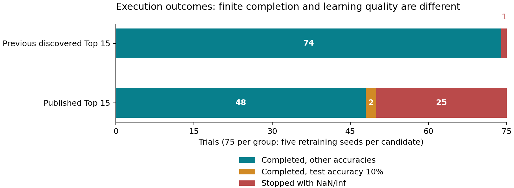
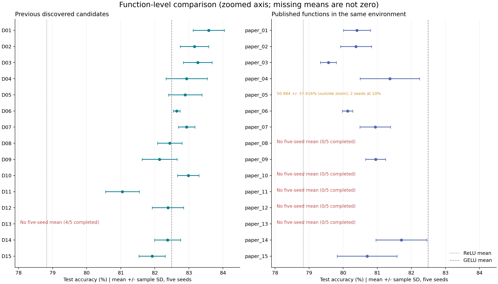

# 前回の探索Top 15と論文Top 15の同条件再学習比較

分析日: 2026-10-25

[English version](README_EN.md)

保存された結果を再検査・再集計した。追加学習や元データの変更は行っていない。対象は前回の新seed 4を含む探索から選ばれた15候補と、今回実行された論文表3の15関数である。

## 結論

**今回の実装・記録された環境・データ分割では、前回の探索候補の方が、観測された最高平均精度と数値的な完了率の両方で良い結果を示した。** ただし、これは当該条件での比較であり、論文の手法全体や別データセットに対する普遍的な優位性を示すものではない。

| 比較項目 | 前回の探索Top 15 | 論文Top 15の今回の再評価 |
|---|---|---|
| 予定試行 | 75 | 75 |
| 50エポック・テスト評価完了 | 74/75 (98.67%) | 50/75 (66.67%) |
| NaN/Inf停止 | 1/75 (1.33%) | 25/75 (33.33%) |
| 5シードすべて完了した候補 | 14/15 | 10/15 |
| 完了試行のうちテスト精度10% | 0 | 2 (paper_05, seeds 0, 3) |
| 最高平均±SD (%) | discovered_01: 83.582 ± 0.460 | paper_14: 81.710 ± 0.747 |

前回の最良候補と今回再評価した論文関数中の最良関数の差は **+1.872ポイント**。論文で最良だったEELU-4の今回の再評価値との差は **+3.176ポイント**。前回の完了14候補のうち13候補が論文関数中の最高平均81.710%を上回った。

候補07と10は数学的に同一の関数で、前回の15候補には重複が含まれる。上記13候補にもこの2件が含まれるため、異なる13種類の関数と解釈しない。

## 1. 比較条件と検証範囲

| 項目 | 条件・確認結果 |
|---|---|
| Data | CIFAR-10: 45,000 train / 5,000 validation / 10,000 test |
| Retraining | 50 epochs from scratch; seeds 0, 1, 2, 3, 4 |
| Optimization | SGD; learning rate 0.01; momentum 0.9; batch size 64 |
| CNN | 6 convolutions: 28, 32, 64, 64, 128, 128; dropout 0.2; he_uniform |
| Runtime | Linux; RTX 4080 SUPER; Python 3.10.12; TensorFlow 2.21.0; Keras 3.12.4 |
| Packages | NumPy 2.2.6; scikit-learn 1.7.2 |
| Execution | JIT disabled; memory growth enabled; one process per trial |
| Evaluation | Final model after 50 epochs; test set excluded from training |

両計画の設定全体と実行設定、分割ファイルのSHA-256が一致した。論文側で維持対象として記録されたモデル・データ読み込み・演算・学習・集計等の保存コードは、前回の保存コードとハッシュが一致した。workerには環境記録・照合の変更がある。前回105試行（基準関数30試行を含む）と論文側75試行の計180件について、試行ID、設定された関数・seed、CSVとJSONの指標、履歴、保存モデル、環境、集計値を照合した。

分割SHA-256: `fb97511b4fe6df79b37aa851875d193c93e3cef5b6c836e013941f1301fb9858`

全180試行で記録された比較対象の環境項目が一致し、論文側75件の環境チェックも合格していた。ただし元のGPUドライバや全環境変数は未記録で、GPU計算のビット単位一致も保証されない。「同条件」は、この検証可能な範囲を意味する。

平均は5シードすべて成功した関数のみ算出し、SDは標本標準偏差（ddof=1）。失敗を0%に置換したり、成功したseedだけで正式平均を作ったりしていない。以下の差は相対的な増加率ではなく、精度のパーセントポイント差である。

## 2. 論文Top 15の実行状況

**全75試行に終了結果があり、未実行・実行中は0件。50件が完了、25件が数値的失敗。** `all_evaluations_completed=false` は未実行が残っている意味ではなく、全件成功していないためである。保存モデルは50個、モデル保存エラーは0件だった。



青緑は10%の2件を除く完了試行、橙は完了してもテスト精度10%だった試行、赤はNaN/Inf停止。前回の基準関数30試行はこの75対75の図に含めない。

| 関数 | 失敗seed | 完了 | 最初の非有限値epoch | loss NaN | loss Inf | val_loss NaN |
|---|---|---|---|---|---|---|
| paper_08 | 0–4 | 0/5 | 1 | 4 | 1 | 5 |
| paper_10 | 0–4 | 0/5 | 1 | 4 | 1 | 5 |
| paper_11 | 0–4 | 0/5 | 1 | 5 | 0 | 5 |
| paper_12 | 0–4 | 0/5 | 1 | 5 | 0 | 5 |
| paper_13 | 0–4 | 0/5 | 1 | 5 | 0 | 5 |

25件すべてで最初の非有限値は1エポック目。訓練損失は23件がNaN、2件がInfで、検証損失は25件すべてNaN。失敗時のaccuracy・val_accuracyは有限値であり、精度が数値として出ていても学習が正常とは限らない。テスト評価は実施・保存されていない。

論文側75件のログにOOM・Tracebackは0件。layout optimizer警告は75件にあり、成功試行にも現れるため、警告だけで失敗原因とは断定できない。

### paper_05：有限値でも学習が崩れる例

| seed | テスト精度 (%) |
|---|---|
| 0 | 10.00 |
| 1 | 78.22 |
| 2 | 78.98 |
| 3 | 10.00 |
| 4 | 77.72 |

seed 0と3は50エポックを終えてもテスト精度10.00%、最終訓練損失は約2.303だった。これは10クラス分類のチャンスレベルにとどまる挙動であり、正常に高精度へ学習できたとは扱わない。一方、NaN/Infではないため、処理上はcompletedである。5回の正式平均 **50.984 ± 37.416%** にこの2回を含めている。生の予測や勾配がないため、常に特定クラスを予測した等の内部動作は断定しない。

## 3. 論文15関数：今回の再評価と論文報告値

| 論文関数 | 完了 | 論文の平均±SD (%) | 今回の平均±SD (%) | 今回−論文 (pp) |
|---|---|---|---|---|
| paper_01 (EELU-4) | 5/5 | 82.74 ± 0.14 | 80.406 ± 0.396 | -2.334 |
| paper_02 (EELU-2) | 5/5 | 82.67 ± 0.30 | 80.376 ± 0.455 | -2.294 |
| paper_03 (EELU-1) | 5/5 | 82.66 ± 0.29 | 79.566 ± 0.234 | -3.094 |
| paper_04 (EELU-3) | 5/5 | 82.48 ± 0.61 | 81.370 ± 0.873 | -1.110 |
| paper_05 | 5/5 | 82.46 ± 0.54 | 50.984 ± 37.416 | -31.476 |
| paper_06 | 5/5 | 82.44 ± 0.37 | 80.130 ± 0.154 | -2.310 |
| paper_07 | 5/5 | 82.40 ± 0.47 | 80.940 ± 0.451 | -1.460 |
| paper_08 | 0/5 | 82.38 ± 0.39 | 算出なし | — |
| paper_09 | 5/5 | 82.29 ± 0.18 | 80.952 ± 0.293 | -1.338 |
| paper_10 | 0/5 | 82.27 ± 0.35 | 算出なし | — |
| paper_11 | 0/5 | 82.26 ± 0.13 | 算出なし | — |
| paper_12 | 0/5 | 82.25 ± 0.47 | 算出なし | — |
| paper_13 | 0/5 | 82.19 ± 0.51 | 算出なし | — |
| paper_14 | 5/5 | 82.15 ± 0.29 | 81.710 ± 0.747 | -0.440 |
| paper_15 | 5/5 | 82.15 ± 0.33 | 80.704 ± 0.878 | -1.446 |

論文報告値は提供PDF（arXiv:2409.04915v1）の表3から実行計画に転記された値を使用した。`paper_XX`は表3の掲載順であり、EELU番号や今回の精度順位とは異なる。

5回完了した10関数はすべて、今回の平均が論文報告値より低い。paper_05を除いた9関数でも差は−0.440〜−3.094ポイント。論文の最良関数EELU-4は80.406%へ低下し、今回の論文関数中の最高はpaper_14の81.710%だった。これは、関数だけを移植しても論文の精度や順位がそのまま再現されなかったことを示す。

### 論文関数のseed別テスト精度 (%)

| 関数 | seed 0 | seed 1 | seed 2 | seed 3 | seed 4 |
|---|---|---|---|---|---|
| paper_01 | 80.72 | 80.19 | 79.83 | 80.51 | 80.78 |
| paper_02 | 79.71 | 80.75 | 80.10 | 80.72 | 80.60 |
| paper_03 | 79.67 | 79.89 | 79.26 | 79.53 | 79.48 |
| paper_04 | 82.18 | 81.81 | 81.40 | 79.90 | 81.56 |
| paper_05 | 10.00 | 78.22 | 78.98 | 10.00 | 77.72 |
| paper_06 | 80.02 | 80.16 | 80.23 | 79.93 | 80.31 |
| paper_07 | 81.42 | 80.49 | 80.58 | 81.42 | 80.79 |
| paper_08 | NaN/Inf停止 | NaN/Inf停止 | NaN/Inf停止 | NaN/Inf停止 | NaN/Inf停止 |
| paper_09 | 81.19 | 80.80 | 80.58 | 80.89 | 81.30 |
| paper_10 | NaN/Inf停止 | NaN/Inf停止 | NaN/Inf停止 | NaN/Inf停止 | NaN/Inf停止 |
| paper_11 | NaN/Inf停止 | NaN/Inf停止 | NaN/Inf停止 | NaN/Inf停止 | NaN/Inf停止 |
| paper_12 | NaN/Inf停止 | NaN/Inf停止 | NaN/Inf停止 | NaN/Inf停止 | NaN/Inf停止 |
| paper_13 | NaN/Inf停止 | NaN/Inf停止 | NaN/Inf停止 | NaN/Inf停止 | NaN/Inf停止 |
| paper_14 | 81.83 | 80.74 | 81.45 | 82.81 | 81.72 |
| paper_15 | 81.05 | 81.23 | 79.16 | 80.84 | 81.24 |

## 4. 前回の探索Top 15との精度比較

| 平均順位 | 探索候補 | 完了 | 平均±SD (%) | 論文関数の今回最高値との差 (pp) |
|---|---|---|---|---|
| 1 | discovered_01 | 5/5 | 83.582 ± 0.460 | +1.872 |
| 2 | discovered_03 | 5/5 | 83.260 ± 0.422 | +1.550 |
| 3 | discovered_02 | 5/5 | 83.162 ± 0.418 | +1.452 |
| 4 | discovered_10 | 5/5 | 82.982 ± 0.316 | +1.272 |
| 5 | discovered_04 | 5/5 | 82.934 ± 0.607 | +1.224 |
| 5 | discovered_07 | 5/5 | 82.934 ± 0.239 | +1.224 |
| 7 | discovered_05 | 5/5 | 82.892 ± 0.490 | +1.182 |
| 8 | discovered_06 | 5/5 | 82.642 ± 0.100 | +0.932 |
| 9 | discovered_08 | 5/5 | 82.438 ± 0.361 | +0.728 |
| 10 | discovered_12 | 5/5 | 82.384 ± 0.460 | +0.674 |
| 11 | discovered_14 | 5/5 | 82.374 ± 0.382 | +0.664 |
| 12 | discovered_09 | 5/5 | 82.140 ± 0.516 | +0.430 |
| 13 | discovered_15 | 5/5 | 81.920 ± 0.385 | +0.210 |
| 14 | discovered_11 | 5/5 | 81.050 ± 0.493 | -0.660 |
| — | discovered_13 | 4/5 | 算出なし | — |

表示精度で同じ82.934%の候補04・07は同順位。候補13はseed 1が50エポック目にNaNとなり、5回平均は未算出。候補13の成功seed 0,2,3,4は81.31%, 79.95%, 81.84%, 81.57%。この4回平均を比較表の順位に入れていない。



図は平均±標本SD。横軸を拡大しており、paper_05の50.984%は範囲外と注記した。算出できない平均を0%で描いていない。破線は前回の基準関数の平均で、新たな基準関数の再実行ではない。

### 最良関数同士を同じseedで比較

| seed | discovered_01 (%) | paper_14 (%) | 差 / Difference (pp) |
|---|---|---|---|
| 0 | 83.82 | 81.83 | +1.99 |
| 1 | 83.75 | 80.74 | +3.01 |
| 2 | 82.77 | 81.45 | +1.32 |
| 3 | 83.69 | 82.81 | +0.88 |
| 4 | 83.88 | 81.72 | +2.16 |

discovered_01は全5シードでpaper_14を上回った。平均差は+1.872ポイント。EELU-4との平均差は+3.176ポイント、今回のEELU群で最も高いEELU-3との差は+2.212ポイントだった。これらは観測差であり、有意差検定の結果ではない。最良関数はテスト結果を見て比較対象として選んでいるため、選択の影響もある。

## 5. 基準関数との位置関係

| 基準関数 | 完了 | 平均±SD (%) |
|---|---|---|
| relu | 5/5 | 78.824 ± 0.601 |
| swish | 5/5 | 81.794 ± 0.545 |
| mish | 5/5 | 81.124 ± 0.601 |
| gelu | 5/5 | 82.490 ± 0.448 |
| serf | 5/5 | 80.462 ± 0.592 |
| elu | 0/5 | 算出なし |

基準関数は前回の105試行に含まれる結果を参照した。今回の論文75試行で再実行していない。論文関数の最良paper_14はGELUより0.780ポイント低く、Swishより0.084ポイント低い。前回の探索候補では8候補がGELUを上回った。前回のELUは全5シード失敗のため比較可能な平均がない。

## 6. 解釈・限界・次の確認

1. **今回の実装への適合性:** 前回の候補はこのデータ分割・実装を使った検証精度で選ばれた。一方、論文関数は別実験で選ばれた固定集合である。前回候補の精度・完了率が高いことは、この条件への適合性と整合するが、差の原因を一つに特定する証拠ではない。
2. **元論文の完全再現とは区別:** 両群の比較条件は照合したが、元論文の厳密な分割・実行環境まで同一とは確認できない。EELU-2は表4の重複した実装欄ではなく数式を使用。EELU-3は既存演算木の積の形、softplusは前回と同じ安定実装を使用している。
3. **NaN/Infの発生源は未確定:** OOMは記録されていない。例えば失敗したpaper_13=`max(x,erf(x))`にはexpも定義域制約のある逆三角関数もないため、全失敗をexpのオーバーフローだけで説明できない。最初の非有限値が活性化・畳み込み・勾配・重み更新のどこで生じたかを記録する必要がある。
4. **失敗を除く集計の限界:** 未完了関数を除いた群全体の平均や、10%の2試行を除いたpaper_05の平均を主結果にしない。完了率と精度を併記し、欠測を隠さない。
5. **次の実験:** paper_08/10/11/12/13のseed 0を診断用に計測し、paper_05のseed 0・3では初期出力・損失・勾配の推移を調べる。前回の候補13 seed 1とELUも未解決。学習率変更・クリッピング等は元の記録を上書きせず、別実験として報告する。
6. **一般化の限界:** 5シードは同じデータ分割での学習の反復であり、独立した5データセットではない。別分割・別モデルや、独立に固定した比較計画での追加検証が必要。

## 付録：比較した関数の式

式は実行計画に保存された表記。`log(1+exp(x))`は実装では`tf.nn.softplus`。

| 前回の探索候補 | 関数式 |
|---|---|
| discovered_01 | `(erf(x)*sigmoid(sinh(x)))` |
| discovered_02 | `(sigmoid(x)*erf(erf(x)))` |
| discovered_03 | `(atan(x)*sigmoid(sinh(x)))` |
| discovered_04 | `(asinh(x)*sigmoid(sinh(x)))` |
| discovered_05 | `(sigmoid(x)*erf(sin(x)))` |
| discovered_06 | `(asinh(x)*sigmoid(x))` |
| discovered_07 | `(sigmoid(x)*erf(x))` |
| discovered_08 | `(sigmoid(x)*erf(sinh(x)))` |
| discovered_09 | `max(min((exp(x)*erf(tanh(x))),0),(x*sigmoid(max(x,0))))` |
| discovered_10 | `(erf(x)*sigmoid(x))` |
| discovered_11 | `max(min((log(1+exp(x))*erf(x)),0),min(tanh(x),sin(x)))` |
| discovered_12 | `(max(min(sin(x),0),x)*erf(sigmoid(x)))` |
| discovered_13 | `((atan(x)*min(x,0))+tanh(x))` |
| discovered_14 | `min((log(1+exp(x))*erf(x)),(atan(x)*erf(atan(x))))` |
| discovered_15 | `(sin(x)*sigmoid(asinh(x)))` |

| 論文関数 | 関数式 |
|---|---|
| paper_01 | `(erf(x)*log(1+exp(x)))` |
| paper_02 | `((-x)*erf(exp(-x)))` |
| paper_03 | `(x*erf(exp(x)))` |
| paper_04 | `((x*erf(exp(x)))*erf(exp(x)))` |
| paper_05 | `(max(x,min(x,0))*erf(min(x,0)))` |
| paper_06 | `((max(x,0)*erf(atan(x)))+(-x))` |
| paper_07 | `(log(1+exp(x))*erf(erf(x)))` |
| paper_08 | `((tanh(x)+max(x,0))*sigmoid((log(1+exp(x))*erf(atan(x)))))` |
| paper_09 | `(log(1+exp(x))*tanh(x))` |
| paper_10 | `max((sin(x)*sigmoid(sin(x))),((x*erf(x))+tanh(x)))` |
| paper_11 | `((tanh(x)+max(x,0))*sigmoid((log(1+exp(x))*erf(sinh(x)))))` |
| paper_12 | `((x*erf(x))+sin(x))` |
| paper_13 | `max(x,erf(x))` |
| paper_14 | `((max(x,0)*atan(x))+(-x))` |
| paper_15 | `max((log(1+exp(x))*tanh(x)),erf(x))` |

## データと再現方法

- [Previous trial results](../../paper_full_results/retrain_runs/pooled_top15_updated/results/retraining_results.csv)
- [Previous function summary](../../paper_full_results/retrain_runs/pooled_top15_updated/results/retraining_summary.csv)
- [Published-function trial results](../../paper_full_results/published_top15_matched/results/retraining_results.csv)
- [Published-function summary](../../paper_full_results/published_top15_matched/results/retraining_summary.csv)
- [Published-function execution status](../../paper_full_results/published_top15_matched/status.json)
- [Published formulas and original reported values](../../paper_full_results/published_top15_matched/selected_top15.csv)
- [Audit and input hashes](audit.json)
- [Reproduction script](analyze.py)
- Reference: *Activation Function Optimization Scheme for Image Classification*, arXiv:2409.04915v1, Table 3; previous baseline context from Table 6.

再生成には両実験のplan・source_snapshot・split・trials・resultsとPython / matplotlibが必要。リポジトリ直下で次を実行する。新しい学習は行わない。

```bash
python analysis/top15_matched_comparison/analyze.py
```
